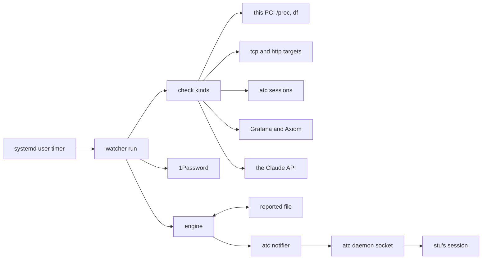

# Architecture overview

This repo holds the programs that stu, the owner's conversation, needs to run. It holds one program:
the watcher. A systemd user timer starts the watcher once a minute on the owner's PC. Each run
checks the PC and the services the owner cares about, and sends stu an atc message for each fault
that opened or recovered since the last run. Nothing in the repo listens on a port.

## The run path

The timer starts one short-lived process per run. The process reads its config, runs each due check,
decides what changed, and sends each change before it exits. [The watcher](./watcher.md) covers the
engine, the reported file and the sends.

## Topology

The watcher runs on the owner's PC, outside every atc session, and reaches atc through the daemon's
unix socket. The check kinds read this PC directly, open TCP connections and HTTP requests to the
targets in the config, and read the session list from atc. The alert kinds ask Prometheus for its
firing alerts through Grafana on the tailnet, and ask Axiom's API for each monitor's notifications.
The watcher reads each secret in the config from 1Password with `op` before the check runs, and the
quota kind asks the Claude API for each Claude slot's rate-limit use. Every connection starts from
the watcher, so nothing needs a public address.

## Data

The watcher keeps one JSON file, the reported file, which holds each fault stu has heard about and
each message stu is still owed. It keeps nothing else, because the file is all it needs to avoid a
repeat. Hostnames, tunnel addresses and session ids live in a local config that git ignores, because
the repo is public. Tokens live in 1Password, and the config holds only `op://` references to them.
[Run the watcher](../guides/run-the-watcher.md) covers the config.

## Code layout

The code follows the package layout in [AGENTS.md](../../AGENTS.md#layout). The engine is a module,
so it does no I/O, and it takes the time, the checks and the notifier as arguments. Each outside
system, such as atc or this PC's `/proc`, has its own adapter, and the watcher app builds the
adapters and passes them in.
