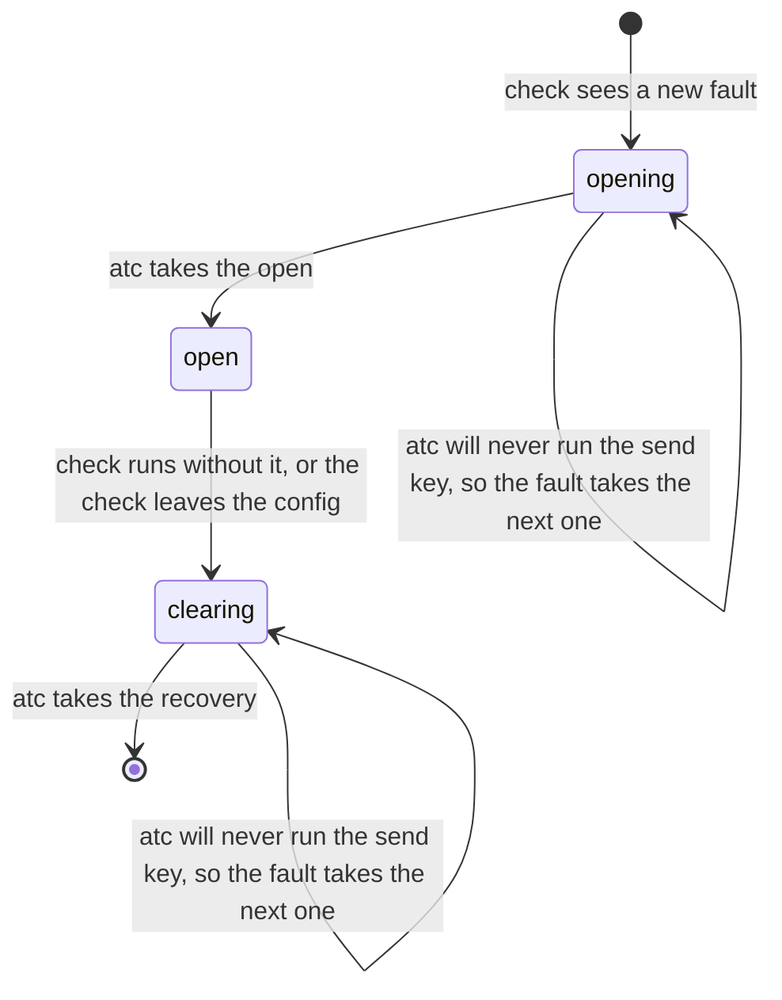

# The watcher

The watcher tells stu when something of the owner's breaks, and again when it recovers. stu gets one
message when a fault opens and one when it clears, and never a message when nothing changed. The
watcher remembers what stu has heard in one JSON file, the reported file, so a restart sends nothing
twice. Each message reaches stu through atc as a message from a local program named `stu-watch`.

[The overview](./overview.md) shows where the watcher runs and what it talks to.

## Checks and kinds

A check is one entry in the config: an id, a kind, and the kind's params, such as a host and a port
for `tcp`. Each kind maps its params to the faults it sees now. Each fault has a key that stays the
same from run to run, such as a path or a session id, and one line of text for stu. A kind that
cannot look, such as a `df` that fails, throws.

The engine prefixes each fault key with its check id, so two checks never share a key. A check id
holds no `:`, so the bare id is free for the check's own cannot-run fault: a check that throws or
runs past its timeout opens that fault, and its next good run clears it. A check that throws clears
none of its other faults, because a check that cannot look has not seen them recover.

The watcher process exits when the run ends, which stops a probe still running past its timeout, and
the service stops a run that outlives its own time limit, so one hung probe never holds back the
next run. The watcher kills a program it runs, such as `op read`, at the program's timeout, together
with every process the program started. The timeout runs until the program exits and its output
closes, so a process the program leaves running with that output open dies at the timeout too. A
process that moves itself to a session of its own escapes that kill.

No send starts once the run is past its send window, and a send still running a little after the
window closes is cut. A send it skips or cuts stays owed for the next run, so a hung atc still
leaves the run time to save what it found.

A check with `everyMin` runs when that many minutes have passed since its last run, less a few
seconds of slack, so a timer that fires a little early still runs it. A run that throws still counts
as a run, so a slow kind keeps its interval while it fails.

The kinds get read-only ports, and no kind's package depends on the notifier, so no kind can send
stu a message. The session kinds read atc through a port that offers only reads. The quota kind runs
`op` through a port that returns the exit code and stdout and drops stderr. The alert and quota
kinds call HTTP through a `fetch` port that the app passes in, so a test answers their requests
without a server.

## The alert and quota kinds

Three kinds read what other systems already watch. Each one throws when it cannot read its source,
so the engine opens the check's cannot-run fault and reports none of the source's faults as
recovered. The engine sends a thrown message to stu, so a kind never puts a token, a URL, an `op://`
reference or a response body in one.

| Kind                | Reads                                                                 | Fault key                                                                         |
| ------------------- | --------------------------------------------------------------------- | --------------------------------------------------------------------------------- |
| `alerts-prometheus` | `ALERTS{alertstate="firing"}`, through Grafana's datasource proxy     | the alert's labels without `__name__` and `alertstate`, sorted, as `name="value"` |
| `alerts-axiom`      | each monitor's recent notifications, from Axiom's API                 | the monitor's id                                                                  |
| `quota-anthropic`   | each Claude slot's unified rate-limit headers, from a 1-token request | the slot's id in the config                                                       |

`alerts-prometheus` drops what Alertmanager never sends on. It drops `Watchdog` and `InfoInhibitor`,
which Alertmanager routes to its null receiver. It also applies the chart's three default inhibit
rules, where a missing label equals a missing label:

- a `critical` alert silences a `warning` or `info` alert with the same `namespace` and `alertname`;
- a `warning` alert silences an `info` alert with the same `namespace` and `alertname`;
- a firing `InfoInhibitor` silences every `info` alert in its `namespace`.

These rules are a copy of the observability stack's, so a change to the stack's inhibit rules needs
the same change here.

`alerts-axiom` counts a monitor as firing while the newest notification in its history is `open`.
When an `open` and a `closed` notification share the newest time, the monitor counts as firing.
Axiom records notifications sent, not state changes, so the kind reads only `Threshold` and
`AnomalyDetection` monitors that are enabled and send resolved notices. The kind asks for no history
of any other monitor, because its newest notification can stay `open` after its condition ends. A
monitor type the kind doesn't know makes it throw. A monitor open for longer than the kind's history
window with no new notification reads as resolved.

`quota-anthropic` reads every slot at once, each slot's token with `op read` and then its use,
because one `op read` can take several seconds and the check has a time limit. A slot is over its
limit when its `7d` use is at or above `sevenPct`, and each slot over its line gives one fault. The
kind reads no `5h` use, because the subscription has no `5h` window. The request asks for
`claude-haiku-4-5`, because the subscription route answers `claude-haiku-5-5` with a 429 that has no
use headers. An answer, a 429 included, counts as a reading when it carries the `7d` use header.
When any slot cannot be read, the whole check throws, so a 1Password outage opens one fault.

## What a fault owes stu

Each fault in the reported file is in one of three phases. An opening fault owes stu its open
message, an open fault owes nothing, and a clearing fault owes stu its recovery. A send that atc
takes moves the fault on, and a send that fails leaves the fault owing it, so the next run sends it
again.

A run first resends what earlier runs still owe, then decides what changed. A fault that still owes
a send after that resend is left as it is. So a fault whose open stu may not have yet keeps owing
the open, even when it clears: the open may have reached stu with its reply lost, and a recovery for
an open stu never got would confuse it. Once atc takes the open, the recovery follows. A fault that
comes back after its recovery was sent opens again, with a new open time.

Every send key is in the file before its first try, and the run saves the file again after each send
that atc takes. A run killed between a send and its save leaves the send owed, and the next run's
resend settles it, as the next section describes.

## Sending each change once

Every owed send carries an idempotency key, made from the fault key, the kind of send and the time
the fault opened. The engine stores the key in the reported file before the first try. atc runs a
key once and answers a repeat with the first send's message, so a resend of a message that reached
stu adds nothing.

atc refuses to run a key again in two cases:

- atc answers `outcome_unknown` when it cannot tell whether the first send ran. The notifier asks
  atc for the message whose id the error holds. When atc holds it, the send counts as taken. When
  atc answers that it holds no such message, or the error holds no id, the watcher needs a new key.
- atc answers `idempotency_conflict` when a resend differs from the first send, such as after the
  owner changes the session in the config. The watcher needs a new key.

For a send that needs a new key, the engine adds a counter to the old key and saves the file before
it sends again. A lost reply to that send then replays on the next run, and stu still gets one
message.

atc keeps a used key for a fixed retention, which its hello answer gives. A resend after that
retention, such as after the PC slept, reaches stu twice.

## How the notifier reaches atc

The notifier calls atc on the atc daemon's client socket, `atc-daemon.sock`. atc also opens
`atc.sock` in the same folder. Session hooks report on `atc.sock`, and it answers no client call.
The daemon puts both sockets in `$XDG_RUNTIME_DIR` as its own environment sets it, or in
`~/.local/state/atc` when that variable is unset. A systemd user unit can get a different
`$XDG_RUNTIME_DIR` from the daemon's. So the notifier first tries `atc-daemon.sock` under its own
`$XDG_RUNTIME_DIR`, then the socket path that the daemon records in
`~/.local/state/atc/daemon.json`.

On that socket the notifier calls atc's procedures through the contract that `@atcx/contract`
publishes, sent as oRPC peer messages, one JSON message per line, as atc's own clients send them.

## How atc labels the sender

atc labels a message by who sent it. A program outside every atc session, whose hello gives a client
name that does not start with `atc/`, sends as `local`, and atc labels its message with the `from`
it gives. The notifier's hello gives the client name `stu-watch/<version>` and sends with
`from: "stu-watch"`. A run started from a session's shell reaches stu as that session, because atc
identifies the caller from the kernel first. The systemd user service runs outside every session.

The notifier speaks atc's protocol version 14. A daemon on another version refuses the hello with
its own version, and the notifier retries once with that version. A change to the hello or to the
message request still breaks the send, and the owed message waits in the reported file until a fix.
Raising the pinned `@atcx/contract` version shows such a change as a type error in the notifier.

## Limits

- Nothing watches the watcher. A stopped timer is silent.
- A probe from this PC fails when the PC's own network is down, so the tcp and http kinds then
  report faults that are this PC's.
